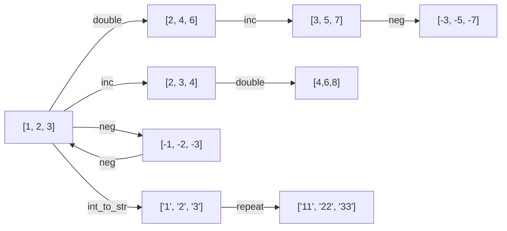
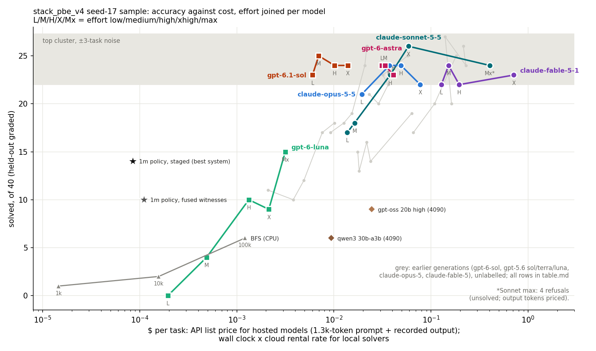

# Wandering Light

[](https://github.com/abhishekraok/wandering-light/actions/workflows/python-package.yml)
[](https://opensource.org/licenses/Apache-2.0)

[](https://github.com/astral-sh/ruff)

Programming by example (PBE) as a training ground for solvers that learn from
the outcome of their own actions. A task is a set of input/output pairs; a
solution is a program over a fixed basis of pure functions that maps every
input to its output. The repository holds two substrates, the corpora
generated on them, search and learned-policy solvers, and the measurements
that compare them on one objective, **cost to clear** a task set.

## What is here

- **Two substrates.** `wl-core-v1`: 118 single-argument pure functions over
  typed lists (`TypedList`, `FunctionDef`, `Executor`). The stack machine
  (`stack_machine.py`): a guarded concatenative machine with quotations and
  combinators, in three named bases, `executable-26`, `full-52` and `mark-28`.
  Basis sets are versioned and content-addressed under `basis_sets/`.
- **Corpora on the Hugging Face Hub**, with only their manifests in git.
  `deep-corpus-v1`/`v2`: certified shortest-path tasks on `wl-core-v1` at
  distances 1–8. `stack_pbe_v3`/`v4`: behaviour-first PBE tasks on `mark-28`
  over 40 and 220 hand-written behaviours, each task carrying 8 held-out
  examples so a candidate program is graded on data it was never shown.
- **Solvers.** Random, BFS, LLM (OpenAI, Anthropic, Gemini, Ollama, local HF
  checkpoints), and learned next-op policies of 90K–10M parameters
  (`rollout_policy.py`, `stack_policy.py`) driving materialised-state beam
  search (`RolloutPredictor`, `stack_beam.py`).
- **Tools.** A graph-first corpus explorer, a rollout debugger that replays
  the production search one expansion at a time, a Streamlit results
  dashboard, and a single-file stack-machine explorer.
- 1,000+ tests, ruff-clean, CI on GitHub Actions. Everything runs on a single
  machine; a GPU is optional.

## Motivation
Currently LLMs are trained to imitate text on the internet.
As a result they do not know what they know and do not know, which causes hallucination.
They lack a world model (See Sutton's [age of experience](https://storage.googleapis.com/deepmind-media/Era-of-Experience%20/The%20Era%20of%20Experience%20Paper.pdf)).
Instead of next token prediction we would like a training approach that lets models take action and learn from its outcome.
We call this self supervised tool-use learning (SSTL).
We can consider function calling or tool use as taking an action.
We also want a task that is infinitely scalable for learning, bound only by computation.
Programming by Example (PBE) provides such an environment, where the model is tasked to find a series of functions that transforms a given inputs to outputs.

We would like to develop some **meta cognition capabilities** in the model.
Given any task the model should be able to classify it into one of these 3 possibilities.

  1. Confidently say it can solve this
  2. Confidently say it cannot solve this
  3. Unsure

This lets it keep learning boundlessly in the future by exploring the unsure tasks.
A value function in the RL paradigm should help with this.

### The tasks
On the typed-list substrate each state is a list of values (e.g. the integers `[1,2,3]`).
Using the naming convention of [Absolute Zero Reasoner](https://github.com/LeapLabTHU/Absolute-Zero-Reasoner):



**Induction.** Train a solver that finds the shortest path between two states
(`[1,2,3] -> [3,5,7]`), a path being a sequence of pure functions such as
`double, inc`. The typed-list functions take one argument and return one value;
the stack machine is the multi-argument substrate, where a program is a
sequence of ops over a stack and a task is several input/output pairs one
program must satisfy at once.

**Propose.** The learned proposer was retired ([why](https://github.com/abhishekraok/wandering-light/issues/27)): tasks
now come from generators, a certified-shortest sweep on the typed-list
side and a hand-written behaviour catalogue on the stack machine, so each task
carries a certified distance or an authored witness rather than an estimate.

## Results



Solved of 40 on a fixed `stack_pbe_v4` eval sample against dollars per task, for hosted LLMs at each reasoning effort, local LLMs, BFS and this repo's 1m-parameter learned policy ([details](reports/stack-pbe-v4-effort-sweep-20260927/README.md)). Includes [Sonnet 5.5 at five efforts](reports/stack-pbe-v4-sonnet55-20260928/README.md), [GPT-6.1 Sol at four](reports/stack-pbe-v4-sol61-20260929/README.md), [Haiku 5.5 at five](reports/stack-pbe-v4-haiku55-20261011/README.md), [GPT-6.1 Terra at five verified efforts](reports/stack-pbe-v4-terra61-20261027/README.md) and [Fable 5.2 at low only](reports/stack-pbe-v4-fable52-20261110/README.md).

[`docs/RESULTS.md`](docs/RESULTS.md) has the headline numbers for language
models, search and the learned policies on both substrates, and
[`docs/RESULTS_DETAILED.md`](docs/RESULTS_DETAILED.md) every run, including the
earlier induction/proposer line whose checkpoints remain on the Hub.
[`docs/STATUS.md`](docs/STATUS.md) says what those numbers establish and
whether the project is currently active. Training curves for the earlier line
are in
[WandB](https://wandb.ai/abhishekraok-na/wandering-light-rl_proposer/reports/Initial-Wandering-Light-project-report--VmlldzoxNjExOTQ3Mg).

## Installation
Python 3.12 or later (CI pins 3.12.8). We use [uv](https://docs.astral.sh/uv/);
the committed `uv.lock` pins every transitive dependency, and `torch` comes from
the CUDA 12.8 index, which also runs on CPU.

```bash
git clone https://github.com/abhishekraok/wandering-light.git
cd wandering-light
uv sync --extra dev --extra experiments   # what CI installs; both extras are needed for the tests
```

Then either activate the venv (`source .venv/bin/activate`) or prefix commands with `uv run`.
The two browser tests need `uv run playwright install chromium` once and skip themselves without it.

Corpus payloads live on the Hub and are fetched, digest-checked, from their tracked manifest:

```bash
uv run python -c "from wandering_light.corpus_hub import fetch_corpus; fetch_corpus('wandering_light/evals/data/stack_pbe_v4/manifest.json')"
```

<details>
<summary>Don't have uv? Fallback with pip</summary>

```bash
python3 -m venv .venv && source .venv/bin/activate
pip install -e ".[dev,experiments]"
```
Note: pip won't respect `uv.lock`, so transitive versions may drift.
</details>

## Testing

```bash
uv run pytest              # offline; excludes the tests marked `network`
uv run pytest -m network   # model downloads; the rollout-debugger replay tests also need a Hub token for the private policy checkpoint
uv run ./lint.sh ci        # what CI runs: ruff check + ruff format --check
```

Run the linter through `uv run` so the pinned ruff is used rather than one on `PATH`.

## Project Structure

```
.
├── wandering_light/
│   ├── typed_list.py, function_def.py, executor.py, trajectory.py   # typed-list substrate
│   ├── common_functions.py          # the 118 wl-core-v1 functions
│   ├── basis_set.py, basis_sets/    # versioned, content-addressed basis manifests
│   ├── stack_machine.py             # the guarded concatenative machine and its three bases
│   ├── stack_pbe.py                 # behaviour catalogue and behaviour-first task generation
│   ├── stack_pbe_eval.py            # held-out grading of candidate programs
│   ├── quotation_guard.py           # search-level pruning of open-quotation states
│   ├── solver.py                    # random, BFS, LLM and rollout (beam) solvers
│   ├── rollout_policy.py, stack_policy.py, stack_beam.py   # learned next-op policies, beam search
│   ├── compute_optimal.py           # cost-to-clear metrics, certified optimal-action sets
│   ├── corpus_hub.py, policy_hub.py # Hub fetch/publish for corpora and policy checkpoints
│   ├── shortest_path_data.py, stack_machine_corpus.py   # certified-shortest corpus generation
│   ├── proposer_pilot/graph.py      # TrajectoryGraph, the persistent state graph
│   ├── rollout_debugger/            # interactive rollout debugger (see its README)
│   ├── stack_debugger/              # the same for the mark-28 beam on stack_pbe_v4
│   ├── evals/                       # run_evaluation, trajectory_graph_app, dashboard, explorer, data manifests
│   └── training/                    # sft.py, rl_grpo.py, deep-corpus tokenizer and data
├── experiments/                     # the scripts behind every report
├── reports/                         # one directory per measured run
├── docs/                            # STATUS, RESULTS, RESULTS_DETAILED, metrics, stack_machine_explorer.html
├── web/trajectory-graph/            # Vite/TypeScript client for the graph explorer
├── web/stack-workshop/              # Vite/TypeScript client for Signal House (see its README)
└── tests/
```

## Usage

### Run the current best system on a task file
```bash
uv run python -m wandering_light.solve tasks.jsonl.gz
```
`tasks.jsonl.gz` holds one `stack_pbe` task per line (`.jsonl` or `.jsonl.gz`,
the format `python -m wandering_light.stack_pbe` writes; a corpus directory
also works). Every task is attempted in file order and graded on its held-out
examples; the output is one line per task with the verdict and the wall-clock
charged, then the pair `docs/metrics.md` defines: coverage and total wall-clock
over every task attempted, solved or not. Programs solved earlier in the run
are replayed before each search, inside the clock. What "the best system" is
lives in one record, `BEST` in `wandering_light/solve.py`: a checkpoint pinned
to a Hub revision (fetched once, into `~/.cache/wandering-light/`; the repo is
private, so `hf auth login` first) and the search it runs under. It changes
only with a cohort measurement on
[best-system-command (#158)](https://github.com/abhishekraok/wandering-light/issues/158).

### Solve a typed-list task
```python
from wandering_light.common_functions import basic_fns   # wl-core-v1, 118 functions
from wandering_light.solver import get_solver_by_name
from wandering_light.typed_list import TypedList

solver = get_solver_by_name("bfs", budget=1000, max_depth=3)
result = solver.solve(TypedList([1, 2, 3]), TypedList([3, 5, 7]), basic_fns)
print(result.trajectory)   # TL<int>([1, 2, 3]) -> double, inc -> TL<int>([3, 5, 7])
```
`budget` counts basis-function executions for BFS and candidate programs for
random and LLM solvers; `result.cost` reports what was charged.

### Run the stack machine
```bash
uv run python -m wandering_light.stack_machine --basis mark-28 "1 [ 1 add ] i"
```
prints the stack, fuel spent and number of legal ops after each step. `[` and
`]` build a quotation and `i` executes it. The CLI defaults to `full-52`.

### Baselines on `stack_pbe_v4`
After fetching the corpus (see Installation):

```bash
uv run python experiments/stack_pbe_baseline.py --backend bfs --budget 10000 --split eval --out bfs_v4_10k.json
uv run python experiments/stack_pbe_baseline.py --backend llm --provider openai --model gpt-5.6-luna --effort high --tasks 40 --out luna_v4_sample40.json
```

`--tasks 40` draws a fixed 40-task sample; omit it for the whole split. Every
candidate is graded on the task's held-out examples, and a program that fits
only the shown ones is counted as memorised, not solved. `--provider ollama`
runs a local model.

## Evaluation

### Typed-list solvers
Run comparable random/BFS baselines on one frozen cohort:

```bash
PYTHONHASHSEED=0 uv run python -m wandering_light.evals.run_evaluation \
  --eval_file=wandering_light/evals/data/random_inputs.py \
  --solver_names='["random","bfs"]' --num_samples=100 --budget=100 \
  --random_path_lengths='[1,2,3,4]' --bfs_max_depth=4 \
  --seeds='[0,1,2,3,4]'
```

Every result reports `wall_clock_seconds` (the primary comparable cost, pinned
to the evaluation host) and `basis_function_executions` (the hardware-independent
diagnostic). Definitions are in [`docs/metrics.md`](docs/metrics.md).
`PYTHONHASHSEED=0` is required by the default solver basis, `wl-core-pyhash-v1`.

To evaluate a trained checkpoint from the Hub or a local directory:
```bash
PYTHONHASHSEED=0 uv run python -m wandering_light.evals.run_evaluation \
  --eval_file=wandering_light/evals/data/random_inputs_500.py \
  --solver_names='["trained_local"]' --budget=1 \
  --model_name=abhishekraok/induction-basicfns-opt125m-sft434k-rl-6k-with-lp
```

To generate a new evaluation file: `uv run python wandering_light/evals/create_data.py --save`.

### Evaluation dashboard
To browse every past `run_evaluation` result:
```bash
uv run streamlit run wandering_light/evals/dashboard.py
```

### Trajectory graph explorer

The primary corpus explorer is a graph-first local web app:

```bash
uv run python -m wandering_light.evals.trajectory_graph_app   # or: uv run wandering-light-graph
```

Open <http://127.0.0.1:8765> (`WANDERING_LIGHT_GRAPH_PORT` changes the port).
The browser keeps the graph and viewport alive, so panning, zooming, selecting,
dragging, and path highlighting do not rerun Python. Python is called only to
index/query a corpus or perform an explicitly bounded graph expansion.

Choose a corpus and let its one-time background SQLite index finish, then click
a task to draw its stored witness. On the canvas:

- drag the background to pan, use the wheel or trackpad to zoom, and drag nodes
  to untangle a local region;
- click a node to inspect its value and highlight a known path from a root;
- click an edge to inspect all basis functions that produce that transition;
- switch from the selected witness to the bounded same-root witness overlay;
- choose a registered function palette and run a capped local expansion to
  inspect candidate tasks, convergence, cycles, parallel functions, and
  self-loops.

Corpus rows are streamed into a disk-backed SQLite index and fetched in cursor
pages; the full corpus is never retained in Python or sent to the browser. A
missing manifest-backed payload can be fetched explicitly from its pinned Hub
revision and is verified against the manifest digests before indexing.

For frontend development, run `npm ci` once in `web/trajectory-graph`,
then `npm run dev`; Vite proxies `/api` to the Python server. `npm run build`
writes the bundled, offline-capable client served by the command above.

The older Streamlit evaluator remains available for its trajectory editor and
solver-run tools:

```bash
PYTHONHASHSEED=0 uv run streamlit run wandering_light/evals/explorer.py
```

### Rollout debugger
Watch the learned-policy beam search on `deep-corpus-v1` one expansion at a time:

```bash
uv run python -m wandering_light.rollout_debugger.cli serve --port 8000
```

It fetches the published policy checkpoint from the Hub on first use (a Hub
token is needed) or takes `--checkpoint DIR`. Keys and what makes the replay
trustworthy are in [its README](wandering_light/rollout_debugger/README.md).

### Stack debugger
The same instrument for the `mark-28` beam on `stack_pbe_v4`: every shown
example's stack side by side, all 28 ops with the machine's verdict, the
authored witness overlaid, and a play mode that opens `map`, `fold` and `ifte`
into their inner steps:

```bash
uv run python -m wandering_light.stack_debugger.cli serve --port 8010
```

Keys and modes are in [its README](wandering_light/stack_debugger/README.md).

### Stack machine explorer
[`docs/stack_machine_explorer.html`](docs/stack_machine_explorer.html) is a
keyboard-driven, single-file explorer of the stack machine; open it in a
browser.

## Training

### Semantic program embeddings

Encode stack programs or I/O examples into a shared space and retrieve
programs with `wandering_light.program_embedding.ProgramIndex`. The
[embedding report](reports/program-embeddings-20261024/README.md) has the API
and historical retrieval results. Previous weights were removed after a training
objective correction. Train with:

```bash
systemd-run --user --scope -p MemoryMax=12G -p MemorySwapMax=0 -- \
  uv run python -m wandering_light.program_embedding_train --repo-root . \
  --out checkpoints/embeddings --device cuda
```

### Learned next-op policies
The policies behind the results above are small encoders trained on witness
prefixes, selected on validation by beam search:

```bash
uv run python experiments/train_rollout_policy.py --output-dir runs/policy --corpus-dir wandering_light/training/data/deep_corpus_v1 --size-arm 90k --device cpu
uv run python experiments/compute_optimal_mark28.py campaign --run-dir runs/mark28 --train-device cpu --devices cpu   # stack_pbe_v4, three size arms
```

The first trains on `deep-corpus-v1` (the script defaults to `v2`); the second
runs the whole `stack_pbe_v4` sweep, and `--help` lists its single stages. The
exact command, seed and checkpoint behind each published number is in that
run's directory under `reports/`.

<details>
<summary>Legacy LLM line: SFT, GRPO and the proposer</summary>

The original line fine-tuned a small causal LM (OPT-125M) to emit function
lists, then ran GRPO with TRL. The scripts remain; the proposer was retired
([why](https://github.com/abhishekraok/wandering-light/issues/27)).

```bash
PYTHONHASHSEED=0 uv run python wandering_light/training/sft.py --no-eval          # quick check, no online evaluation
PYTHONHASHSEED=0 uv run python wandering_light/training/sft.py --full-run         # full dataset; add --task proposer for the proposer
PYTHONHASHSEED=0 uv run python wandering_light/training/rl_grpo.py --batch-size 32 --model-name $SFT_OUTPUT_DIR --full-run --wandb-run-name $NAME
PYTHONHASHSEED=0 uv run python wandering_light/evals/evaluate_proposer.py --model abhishekraok/proposer-basicfns-opt125m-sft2k --solver-model abhishekraok/induction-basicfns-opt125m-longsft
```

The online evaluation and the proposer scorer load `wl-core-pyhash-v1`, which
refuses to run without a fixed `PYTHONHASHSEED`. Evaluate the SFT output with
the `trained_local` command under Evaluation before starting RL; a success rate
between 30 and 70 % leaves GRPO a gradient.
</details>
