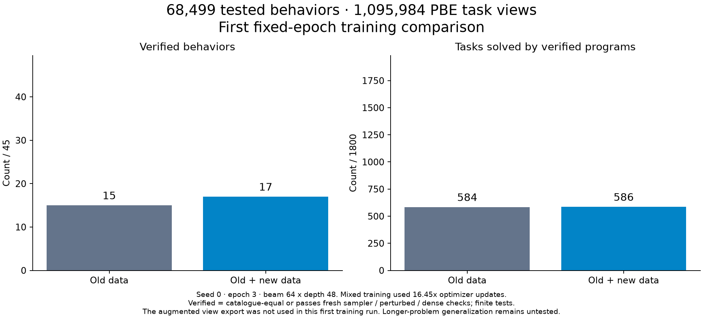

# Large-scale stack PBE

The scale target is met: 68,499 tested behaviors and 1,095,984 task views, 156.57× the old task count. The first training comparison gives a modest gain: **15 → 17 verified behaviors; 584 → 586 tasks**, over all 1,800 frozen v4 tasks. Mixed training gains `all_positive` and `pair_floor_averages`, losing no behaviors; at task level it gains 77 and loses 75.

This is one seed at fixed epoch 3, with **16.45× more optimizer updates** for mixed training. It does not isolate the effect of data from compute. The old arm is a freshly trained control, not an exact reproduction of the pinned `BEST` checkpoint's row sampling. Longer-program generalization remains untested (both searches use depth 48).

[Counts, lengths and training budgets](../../docs/RESULTS_DETAILED.md#large-scale-stack-pbe-2026-10-2425) · [machine-readable metrics](metrics.json) · [large-scale-stack-pbe (#188)](https://github.com/abhishekraok/wandering-light/issues/188).

Raw held-out grading favors old data, 640 → 605 tasks. Fresh reference checks reject 56 old-arm and 19 mixed-arm task solutions as shortcuts, leaving the near-flat verified task result above. Accepted programs either match the catalogue witness (278 old / 208 mixed tasks; no fresh draws) or pass the existing sampler, perturbed and dense checks (306 / 378 tasks). These are finite checks, not proofs. [Verified summary](verified-summary.json) · [held-out comparison](heldout-comparison.json).

The [training-fit diagnostic](fit-summary.json) finds better sampled teacher-label fit for mixed training on both old and new pools. It measures training fit, not semantic generalization. A matched-update comparison would be needed to separate data from compute.

Typed stack compositions and explicit algorithms supply most of the volume; Codex-authored programs add variety. Each retained witness agrees with an independently executed Python reference. Behavioral deduplication uses finite shared probes, so fingerprints are empirical equivalence classes. Known witness length is an upper bound, not certified difficulty.

The frozen v4 overlap audit removes 12 detected matches before training. Its 108 inconclusive candidates each take a single integer, an input signature absent from this eval set; they remain in training. Comparisons use up to 64 sampled inputs and do not establish strict family disjointness. The larger view export reuses checked pairs, with a fixed hidden bank disjoint from all shown views. Its zero fuel field means unmeasured. Initial training uses the original one-view tasks, not this augmented export.

Durable outputs are in `/home/abhishekrao/repos/wandering-light/checkpoints/pbe-scale-20261024/`:

- `audit-v4-eval/tasks_train_filtered.jsonl.gz`: retained original tasks.
- `tasks_train_16views.jsonl.gz`: augmented training tasks and adjacent manifest.
- `policies/{old-staged-1m-s0,mixed-1m-s0}/epoch-003/`: weights-only checkpoints, configuration, trainer state and W&B lineage.
- `pipeline_status.json`: completed construction/training stages and return codes.
- `eval-v4/`: complete paired evaluation and fresh-check evidence.
- `fit-diagnostic/`: paired sampled-row fit and exact sample/provenance records.

[Provenance correction](provenance-correction.json): a copied finisher recorded the launch directory's commit instead of the imported worktree's source revision. Original artifacts and hashes are preserved; the sidecar records the actual source evidence. This changes attribution, not the data or training configuration.
