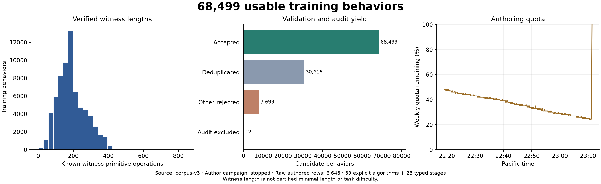

# Large-scale stack PBE

The corpus and both fixed-epoch training runs are complete. Paired evaluation on frozen v4 is running; found programs will also receive the existing fresh-reference check.

[Counts, lengths and training budgets](../../docs/RESULTS_DETAILED.md#large-scale-stack-pbe-2026-10-2425) · [machine-readable metrics](metrics.json) · [large-scale-stack-pbe (#188)](https://github.com/abhishekraok/wandering-light/issues/188).

Typed stack compositions and explicit algorithms supply most of the volume; Codex-authored programs add variety. Each retained witness agrees with an independently executed Python reference. Behavioral deduplication uses finite shared probes, so fingerprints are empirical equivalence classes. Known witness length is an upper bound, not certified difficulty.

The frozen v4 overlap audit removes detected matches; scalar cases with insufficient audit coverage remain disclosed as inconclusive. The larger view export reuses checked pairs, with a fixed hidden bank disjoint from all shown views. Its zero fuel field means unmeasured. Initial training uses the original one-view tasks, not this augmented export.

Durable outputs are in `/home/abhishekrao/repos/wandering-light/checkpoints/pbe-scale-20261024/`:

- `audit-v4-eval/tasks_train_filtered.jsonl.gz`: retained original tasks.
- `tasks_train_16views.jsonl.gz`: augmented training tasks and adjacent manifest.
- `policies/{old-staged-1m-s0,mixed-1m-s0}/epoch-003/`: weights-only checkpoints, configuration, trainer state and W&B lineage.
- `pipeline_status.json`: completed construction/training stages and return codes.

[Provenance correction](provenance-correction.json): a copied finisher recorded the launch directory's commit instead of the imported worktree's source revision. Original artifacts and hashes are preserved; the sidecar records the actual source evidence. This changes attribution, not the data or training configuration.
