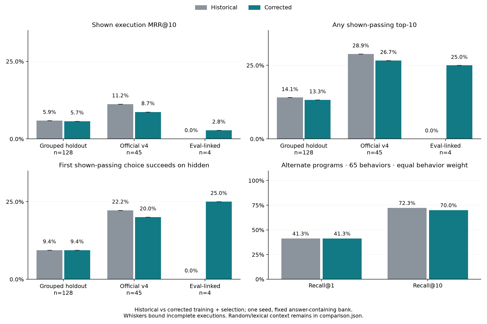
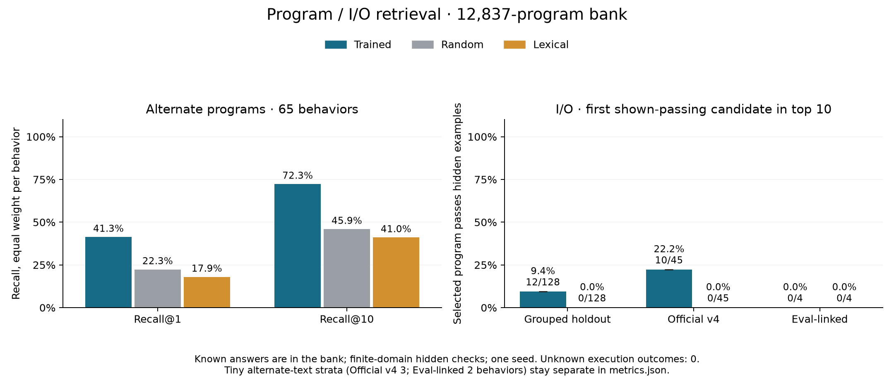

# Program / I/O embeddings



**Corrected retraining, 2026-10-31: no overall retrieval improvement in this seed.**

| Held-out measure | Historical | Corrected |
|---|---:|---:|
| Alternate-program recall@1 / @10, 65 behaviors | 41.3% / 72.3% | 41.3% / 70.0% |
| I/O hidden success, grouped holdout | 12/128 | 12/128 |
| I/O hidden success, official v4 | 10/45 | 9/45 |
| I/O hidden success, eval-linked | 0/4 | 1/4 |

The corrected objective uses execution agreement for both I/O↔program and program↔program supervision. On the grouped holdout, four I/O queries gained hidden success and four lost it; official tasks gained two and lost three. Program top-10 retrieval gained five queries and lost eight (recall weights behaviors equally). All query memberships and the 12,837-program bank match; no unknown execution outcomes. [Metrics/provenance](comparison.json), [paired changes](paired-changes.json).

**Closeness is incomplete.** Across 102 annotated different-style positive pairs, median cosine is 0.738. Yet a verified wrong program is closer than the least similar annotated positive for 86/156 program queries and 118/177 I/O queries, among the sampled negatives. These negatives are the highest token-overlap candidates that fail shown examples. Only one positive pair has token-set Jaccard ≤0.3, so this does not establish broad syntax or staging invariance. [Geometry and protocol](geometry.json).

Keep the corrected weights as the experimental replacement; the historical weights remain deleted. These results do not establish PBE utility: held-out answers are in the bank, only one seed was trained, and the objective and I/O checkpoint-selection rule changed together. The queued matched-budget PBE evaluation remains the next decision; no further training sweep was run.

Artifacts: `/home/abhishekrao/repos/wandering-light/checkpoints/semantic-embeddings-20261031-corrected/` (`aligned-s0/best.pt`, `library.pt`, raw evaluations, manifests and logs). Training used clean commit `b287bc8`, unchanged data digests, and the historical 1,500 + 500 + 500 schedule. Validation selected joint step 1,500 → program step 250 → alignment step 500. Historical shown-execution MRR was replayed from saved top-ten strings without restoring weights: all 354 saved shown-success checks agree. [Training/compare recipe](run_corrected.sh), [historical replay](replay_execution_rankings.py).

W&B: [joint](https://wandb.ai/abhishekraok-na/wandering-light-program-embeddings/runs/vlpjwcvu), [program](https://wandb.ai/abhishekraok-na/wandering-light-program-embeddings/runs/2r2w80s0), [alignment](https://wandb.ai/abhishekraok-na/wandering-light-program-embeddings/runs/ikcpxo2w). CPU lookup median/p95 is 3.22/4.84 ms (45 warm queries, four threads, excludes execution); this was not a controlled timing comparison.

Reproduce with the frozen data snapshots present (about 1h45m on this host):

```bash
systemd-run --user --scope -p MemoryMax=12G -p MemorySwapMax=0 -- \
  bash reports/program-embeddings-20261024/run_corrected.sh
```

The following figure and syntax-control results describe the historical model, whose weights were deleted on 2026-10-31.



| Held-out test | Trained | Random | Lexical |
|---|---:|---:|---:|
| Alternate-text recall@1 / @10, 65 behaviors | **41.3% / 72.3%** | 22.3% / 45.9% | 17.9% / 41.0% |
| I/O hidden success, grouped holdout | **12/128** | 0/128 | — |
| I/O hidden success, all official v4 | **10/45** | 0/45 | — |
| I/O hidden success, eval-linked holdout | 0/4 | 0/4 | — |

Alternate-text ranking improves over both controls; I/O retrieval remains limited. Program metrics weight behaviors equally. I/O grades the first shown-passing top-10 candidate on hidden examples; no unknown outcomes. Tiny official/eval-linked alternate-text strata (3/2 behaviors) stay separate in [metrics.json](metrics.json).

On 47 behaviors with two independently authored implementations, top-10 recall is **66.0%**, versus 39.4% random and 35.1% lexical (descriptive subset). Staged queries reach 88.9% versus 66.7% random on 18 queries: useful tolerance to staging, with misses remaining.

**Keep/discard check (2026-10-28).** Fixed TF-IDF character 3–5-grams and token 1–3-grams reach only 34.1% / 34.4% top-10 recall (independently authored subset: 29.8% / 27.7%). The learned ranking gain survives these syntax baselines. These are exploratory checks after opening the test, with no parameter sweep; one training seed. [Exact results/provenance](syntax-baselines.json), [figure](syntax-baselines.png).

Keep the program retriever as an experimental component. PBE utility is still unmeasured: compare retrieval plus execution verification and the same fallback solver against a simple execution-based library lookup and the solver alone, using a bank built from training data or generated independently before test, fresh tasks, and equal wall-clock budgets. Report both bank coverage and conditional retrieval, verified solves, total time and timeouts. Adopt I/O retrieval only if it improves verified solves or solving time; test near-identical programs with different behavior separately before using distances as equivalence decisions.

Reproduce the added check (no stack execution):

```bash
uv run python reports/program-embeddings-20261024/check_syntax_baselines.py --run-dir /home/abhishekrao/repos/wandering-light/checkpoints/semantic-embeddings-20261024/aligned-s0 --out-dir /home/abhishekrao/repos/wandering-light/checkpoints/semantic-embeddings-20261024/utility-20261028
```

Programs in the repo's `mark-28` stack language and I/O examples map to 128-dimensional unit vectors: **387,344 parameters**, **1.5 MB** of weights; **12,837 programs**, **14.4 MiB** index. Historical warm CPU I/O queries: median **5.09 ms**, p95 **8.91 ms** (45 queries, four threads; encoder/scan/top-k, excluding startup/verification). Encoding performs no execution.

```python
import torch
from wandering_light.program_embedding import ProgramEmbedding, ProgramIndex

run = "/home/abhishekrao/repos/wandering-light/checkpoints/semantic-embeddings-20261031-corrected"
model = ProgramEmbedding.load(f"{run}/aligned-s0/best.pt")
with torch.inference_mode():
    # fold accumulates add over the input list: its sum.
    programs = model.encode_programs(["0 [ add ] fold", "0 [ swap add ] fold"])
    similarity = (programs[0] @ programs[1]).item()
    examples = model.encode_io([[("[ (2 3) ]", "[ 5 ]")]])
index = ProgramIndex(model).fit(["0 [ add ] fold", "nil [ cons ] fold"])
ids, scores = index.search_io([("[ (2 3) ]", "[ 5 ]")], k=10)
neighbors = [index.programs[i] for i in ids.tolist()]
# Or precompute your own bank once:
small = ProgramIndex(model).fit(["0 [ swap add ] fold", "nil [ cons ] fold"])
ids, scores = small.search_program("0 [ add ] fold", k=2)
```

Programs use `mark-28`, the 28-operation basis. Outer brackets delimit a stack; `(2 3)` is one list value. Example order is invariant.

**Protocol.** One-layer bidirectional GRUs, hidden 128/token 48; AdamW, batch 64, temperature 0.07, weight decay 0.01, gradient cap 1, seed 0. Joint: 1,500 steps, rate 0.001, half-batch alternate-text sampling, equal I/O↔program/program↔program losses. Program-only: 500 steps, rate 0.0002, alternate-text sampling only. Frozen-program alignment: 500 steps, rate 0.001, I/O↔program only, half-batch alternate-text sampling. Corrected validation selected joint step 1,500, program step 250, then aligned step 500 before test (historical: 1,500 / 500 / 500). The program-only selector remains annotated alternate-text MRR; joint/alignment use shown-execution MRR@10 lower bounds. Five visible/16 hidden examples maximum. Configuration/W&B lineage: `provenance.json`.

**Objective corrections (2026-10-30/31).** Historical training used record-ID positives. Current I/O supervision executes each in-batch program on the shown subset: matches are positives, completed failures are negatives, and incomplete pairs are excluded from targets and denominators. Program-pair supervision additionally validates both programs on their own shown sets, then requires agreement on both sets; record IDs do not create negatives. The contrastive loss pulls every known positive toward its query. The optional I/O-view auxiliary pulls matching views together without cross-record negatives. A bounded execution cache and optional persistent CPU label workers reduce cost; the retraining used four workers. Training has a one-second deadline per program/example, while evaluation/replay/geometry use one second per candidate example set. All outcomes in this run were known. Metadata records supervision and selection; legacy metadata remains unknown rather than preventing loading.

**Data/caveats.** 9,702 fit / 1,224 validation / 1,290 test behaviors; five insufficient train records omitted. Exact programs merge with aliases; shared templates/alternative skeletons stay in one split. All 45 official v4 behaviors remain held out. Hidden inputs never enter visible views. Contrived/precondition-flagged rewrites are excluded. All 1,101 retained alternate programs pass every stored merged-domain example. Excluded bad Opus `mbpp-876` SHA-256: `0f80c1f45e2d148534defa33e2b6efce5fddaa9dc2bf6837ce97e62fad537a43`.

Peer snapshots are immutable under `/home/abhishekrao/repos/wandering-light/checkpoints/semantic-embeddings-20261024/data/{validated-v2,author-validation-v2}.jsonl`; canonical v4 and reviewed witness sources/digests are recorded in provenance. This is one seed. Equivalence is finite-domain evidence. **Held-out answers are present in the bank**: ranking success does not establish synthesis or coverage by a training-only library.

Related [staged-witness-reauthoring (#155)](https://github.com/abhishekraok/wandering-light/issues/155) found a retrieval gain; its [corrected fixed-reference comparison](../../docs/STATUS.md#superseded) leaves assembled behavior counts level.

```bash
uv run python reports/program-embeddings-20261024/plot_results.py --run-dir /home/abhishekrao/repos/wandering-light/checkpoints/semantic-embeddings-20261024/aligned-s0
uv run pytest tests/test_program_embedding{,_data,_train,_artifacts}.py -q
```

Evaluation is reusable through `wandering_light.program_embedding_eval.evaluate`;
the existing `program_embedding_train.evaluate`, `retrieval_metrics` and
`lexical_vectors` imports remain available. Ranking, tie order, seeded query
sampling, complete banks and execution grading are unchanged. `evaluate` adds
`evaluation_config` with the effective options, including defaults.

New `evaluation.json`, `untrained.json`, `initial.json` and `validation.json`
reports embed `provenance`: evaluator commit/dirty flag, actual model config,
arguments, data manifest/digests, seed, W&B URL, and `evaluation_source`.
`checkpoint_path`/`checkpoint_digest` identify the evaluated checkpoint, with
its complete training lineage in `checkpoint_metadata`; random initialization
records null checkpoint fields. Parent `initial_checkpoint_*` fields are retained
when evaluating a newly trained best checkpoint. Each report snapshots this
metadata independently of `provenance.json` and records effective evaluation
settings separately from training arguments.

New `history.json` files use a version-1 envelope with `history` (the unchanged
step/loss/validation entries) and a detached training-run `provenance` snapshot.
`program_embedding_artifacts.load_training_history(path)` returns
`(entries, provenance)` for new files and `(entries, None)` for legacy bare lists,
including empty histories. Historical history files are not rewritten.

Existing weights-only model (v2) and persistent index (v1) formats are unchanged.
Historical evaluations, metrics and figures are preserved beside the corrected comparison. Plotting
accepts older reports without embedded provenance and records their evaluation
source as unknown with a caveat; it does not infer evaluator provenance from the
library's training commit. Missing metadata never prevents loading or evaluation.
