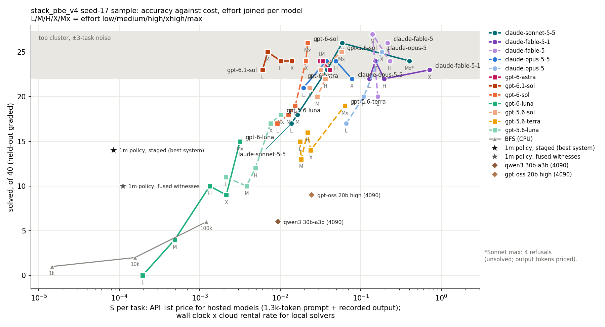

# effort-sweep-5x: GPT-5.6, Fable and local solvers on the v4 40-task sample

Extends new-models-sample40 (#173) with gpt-5.6-sol (all efforts), gpt-5.6-terra / luna (low, medium, xhigh, max; high is #123), claude-fable-5 and claude-fable-5-1 (low to xhigh; max stopped by the owner as wasteful), and local solvers. Same seed-17 40-task eval sample of `stack_pbe_v4`, prompt, parser and held-out grader. Run: `run.sh`; table: `analyse.py > table.md`; figure: `plot.py`.

Updated 2026-09-29 with [Sonnet 5.5 at five efforts](../stack-pbe-v4-sonnet55-20260928/README.md), under the same protocol and cost estimate ($2/$10 per million input/output tokens). Max includes four refusals, scored as unsolved with their output tokens priced. The table's tool/turn column is a CLI turn/permission proxy for Claude; max reports eight on those refusal calls, with tools disabled in the command.

Updated 2026-09-29 with [GPT-6.1 Sol at four efforts](../stack-pbe-v4-sol61-20260929/README.md) ($2/$10 per million): 23 / 25 / 24 / 24 at low..xhigh, in the top band from low at $0.006-0.014/task; max not run.

- **Top of the sample:** fable-5 medium 27, gpt-6-sol max 26, sonnet-5.5 xhigh 26, fable-5 xhigh 26, gpt-5.6-sol max 25, opus-5 xhigh 25 -- all within the ±3-task noise of a 40-task sample. gpt-6-sol reaches that band at ~$0.02/task, Sonnet at ~$0.06, Fable at ~$0.14-0.23.
- **Fable 5.1 is not better than Fable 5 here** (22 / 24 / 22 / 23 against 20 / 27 / 24 / 26), and xhigh costs $0.71/task.
- **Local solvers** (`local/`): the 1m next-op policy (`solve.BEST`, CPU) solves 14 at ~$0.0001/task, above every local LLM (gpt-oss-20b 9, qwen3-30b-a3b 6) and BFS (1 / 2 / 6 at 1k / 10k / 100k nodes). It is trained on the v4 train split, so its solves are mostly retrieval (#155), unlike the zero-shot LLMs.

**Cost.** Hosted models: list price x (1.3k-token prompt + recorded output tokens); gpt-5.6-sol $4/$20 per 1M (promotional since 2026-08-21), fable-5 $10/$50, fable-5-1 $15/$75 (inferred from `claude -p` `costUSD`). Local: wall clock x AWS c7i on-demand vCPU-hour ($0.0446; BFS 1 vCPU, policy 8) or $0.40 per RTX 4090-hour. The policy's one-off training is ~$0.03 of GPU (not folded in); the Opus-authored witnesses it trains on were never priced. Stopped max runs are kept as `*_stopped_partial.json` (fable-5 11 of first 20, fable-5-1 4 of first 4) and not plotted.
