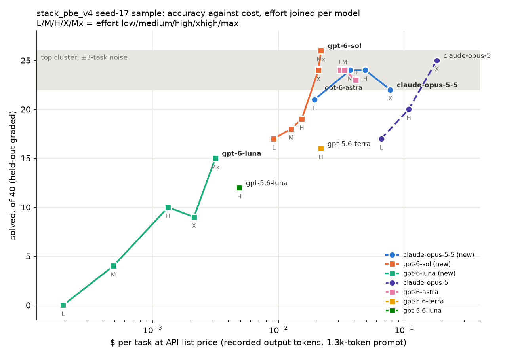

# New models on the `stack_pbe_v4` sample (#173)

[new-models-sample40 (#173)](../../issues/173). The three models released on 2026-09-22 on the
seed-17 40-task eval sample, run under the protocol of
[codex-exec](../stack-pbe-v4-codex-exec-20260910/README.md) (#123) and
[claude-exec](../stack-pbe-v4-claude-exec-20260913/README.md) (#137): one untooled sample per task,
the same prompt, parser and held-out grader, and the trimmed `codex exec` / `claude -p` harnesses on
the subscriptions. The six arms ran concurrently from 12:00 to 12:37 PDT on 2026-09-26. Every Claude
call was served by `claude-opus-5-5`, and no arm made or wrote a tool call.

**The resolution limit was registered before the run.** One-sample noise on 40 tasks is about ±3
tasks, so a gap of 3 or fewer is a tie.

## Result

| model | effort | solved /40 | median thinking tok | $/task at list price |
|---|---|---:|---:|---:|
| `claude-opus-5-5` | low / medium / high / xhigh | **21 / 24 / 24 / 22** | 415 / 583 / 748 / 1,021 | 0.019 / 0.037 / 0.049 / 0.078 |
| `gpt-6-sol` | high | **19** | 894 | 0.015 |
| `gpt-6-luna` | high | **10** | 1,973 | 0.0013 |
| *`claude-opus-5`, earlier* | low / high / xhigh | 17 / 20 / 25 | 526 / 1,400 / 1,962 | 0.066 / 0.109 / 0.182 |
| *`gpt-6-astra`, earlier* | low / medium / high | 24 / 24 / 23 | 256 / 278 / 396 | 0.031 / 0.034 / 0.041 |

- **Opus 5.5 reaches the top cluster at its default effort, `medium`**, and more effort buys nothing
  (24 → 24 → 22). Opus 5 needed xhigh to get there. Opus 5.5 medium and Opus 5 xhigh disagree on 3 of
  40 tasks, with flips in both directions. Only low sits just below the cluster, and even there
  Opus 5.5 is 4 tasks above Opus 5 low.
- **Opus 5.5 spends much less.** Mean output is 709 / 1,607 / 2,195 / 3,620 tokens at low / medium /
  high / xhigh, against Opus 5's 2,377 / 4,096 / 7,015 at low / high / xhigh. At list price, a
  top-cluster row now costs $0.037 per task, about the same as astra and one fifth of Opus 5 xhigh.
  Its knob now behaves like astra's: it is spent (thinking rises 415 → 1,021) but flat on this sample.
- **Effort still turns failures into memorisations.** Memorised goes 8 → 12 → 13 → 17 and shown-only
  72% → 98%, the same pattern #137 found. Where xhigh gains, the gain is a shown-pair fit that fails
  held-out.
- **`gpt-6-sol` at 19 sits between the clusters**, level with Opus 5 high, at $0.015 per task.
- **`gpt-6-luna` at 10 falls in the luna cluster.** Twenty of its 40 programs do not run. That answers
  #173's first question: there is no frontier-level solver at $0.001 per task.
- **The wall past 40 ops holds.** Every new arm solves 0–2 of the 12 tasks past 40 ops.

Every Opus 5.5 arm and `gpt-6-sol` include the `aligned_matches` sampler
shortcut as one of their solves, as every earlier frontier arm did.

## Effort sweep of the GPT-6 models (follow-up, 13:43–15:24 PDT)

`SWEEP=1 run.sh`: `gpt-6-sol` and `gpt-6-luna` at low / medium / xhigh / max (high above).

- **`gpt-6-sol`: 17 / 18 / 19 / 24 / 26** at low → max. It enters the top cluster at xhigh for about $0.02 per task, the cheapest top-cluster point measured. Unlike astra and Opus 5.5 its knob keeps paying through max, and it solves 3–4 of the 12 tasks past 40 ops at xhigh/max, the most of any arm here.
- **`gpt-6-luna`: 0 / 4 / 10 / 9 / 15.** At low it barely reasons (median 20 output tokens) and 37 of 40 programs do not run; 4 low calls hit the 900 s deadline and are left out of the token figures. Max reaches luna-5.6's 12–15 at about $0.003 per task.

## Per-arm detail

Output of `analyse.py`. Buckets are by witness length. Agreement is task-by-task solved or not
against Opus 5 xhigh and astra high. The cost column prices recorded output tokens plus a 1.3k-token
prompt at list prices; Codex's ~6k-token tool-schema residual is left out. No arm spent real money.

| model | effort | solved | memorised | illegal | shown-only | out tok med / mean | 1-10 | 11-20 | 21-40 | 41+ | agree opus5-xh | agree astra-h | $/task | $/1800 | served | tool calls |
|---|---|---|---|---|---|---|---|---|---|---|---|---|---|---|---|---|
| `gpt-6-astra` | low | **24** | 16 | 1 | 100% | 280 / 361 | 8/8 | 8/8 | 7/12 | 1/12 | 37/40 | 37/40 | 0.0310 | 55.9 | - | 0 |
| `gpt-6-astra` | medium | **24** | 16 | 0 | 100% | 307 / 414 | 8/8 | 8/8 | 7/12 | 1/12 | 39/40 | 39/40 | 0.0337 | 60.6 | - | 0 |
| `gpt-6-astra` | high | **23** | 15 | 1 | 95% | 430 / 562 | 8/8 | 7/8 | 7/12 | 1/12 | 38/40 | 40/40 | 0.0411 | 74.0 | - | 0 |
| `gpt-5.6-terra` | high | **16** | 4 | 12 | 50% | 862 / 1,600 | 5/8 | 5/8 | 5/12 | 1/12 | 27/40 | 29/40 | 0.0218 | 39.2 | - | 0 |
| `gpt-5.6-luna` | high | **12** | 6 | 17 | 45% | 2,601 / 3,870 | 6/8 | 4/8 | 2/12 | 0/12 | 27/40 | 29/40 | 0.0049 | 8.8 | - | 0 |
| `claude-opus-5` | low | **17** | 6 | 13 | 57% | 564 / 2,377 | 8/8 | 6/8 | 3/12 | 0/12 | 32/40 | 32/40 | 0.0659 | 118.7 | claude-opus-5 | 0 |
| `claude-opus-5` | high | **20** | 12 | 5 | 80% | 1,433 / 4,096 | 8/8 | 6/8 | 5/12 | 1/12 | 35/40 | 35/40 | 0.1089 | 196.0 | claude-opus-5 | 0 |
| `claude-opus-5` | xhigh | **25** | 13 | 1 | 95% | 1,998 / 7,015 | 8/8 | 8/8 | 8/12 | 1/12 | 40/40 | 38/40 | 0.1819 | 327.4 | claude-opus-5 | 0 |
| `gpt-6-sol` | low | **17** | 8 | 5 | 62% | 410 / 662 | 5/8 | 5/8 | 5/12 | 2/12 | 28/40 | 30/40 | 0.0092 | 16.6 | - | 0 |
| `gpt-6-sol` | medium | **18** | 14 | 5 | 80% | 734 / 1,005 | 8/8 | 6/8 | 4/12 | 0/12 | 33/40 | 35/40 | 0.0127 | 22.8 | - | 0 |
| `gpt-6-sol` | high | **19** | 12 | 3 | 78% | 928 / 1,276 | 8/8 | 5/8 | 5/12 | 1/12 | 32/40 | 34/40 | 0.0154 | 27.7 | - | 0 |
| `gpt-6-sol` | xhigh | **24** | 13 | 1 | 92% | 1,332 / 1,824 | 8/8 | 6/8 | 6/12 | 4/12 | 33/40 | 35/40 | 0.0208 | 37.5 | - | 0 |
| `gpt-6-sol` | max | **26** | 13 | 0 | 98% | 1,576 / 1,926 | 8/8 | 8/8 | 7/12 | 3/12 | 35/40 | 35/40 | 0.0219 | 39.3 | - | 0 |
| `gpt-6-luna` | low | **0** | 0 | 37 | 0% | 20 / 130 | 0/8 | 0/8 | 0/12 | 0/12 | 15/40 | 17/40 | 0.0002 | 0.4 | - | 0 |
| `gpt-6-luna` | medium | **4** | 2 | 27 | 15% | 740 / 719 | 2/8 | 2/8 | 0/12 | 0/12 | 19/40 | 21/40 | 0.0005 | 0.9 | - | 0 |
| `gpt-6-luna` | high | **10** | 1 | 20 | 28% | 2,004 / 2,402 | 3/8 | 6/8 | 0/12 | 1/12 | 25/40 | 27/40 | 0.0013 | 2.4 | - | 0 |
| `gpt-6-luna` | xhigh | **9** | 4 | 21 | 32% | 2,864 / 4,014 | 4/8 | 5/8 | 0/12 | 0/12 | 24/40 | 26/40 | 0.0021 | 3.8 | - | 0 |
| `gpt-6-luna` | max | **15** | 6 | 14 | 52% | 2,968 / 6,058 | 7/8 | 6/8 | 2/12 | 0/12 | 30/40 | 30/40 | 0.0032 | 5.7 | - | 0 |
| `claude-opus-5-5` | low | **21** | 8 | 3 | 72% | 444 / 709 | 8/8 | 7/8 | 6/12 | 0/12 | 36/40 | 38/40 | 0.0194 | 34.9 | claude-opus-5-5 | 0 |
| `claude-opus-5-5` | medium | **24** | 12 | 2 | 90% | 620 / 1,607 | 8/8 | 7/8 | 7/12 | 2/12 | 37/40 | 39/40 | 0.0373 | 67.2 | claude-opus-5-5 | 0 |
| `claude-opus-5-5` | high | **24** | 13 | 3 | 92% | 786 / 2,195 | 8/8 | 8/8 | 7/12 | 1/12 | 37/40 | 37/40 | 0.0491 | 88.4 | claude-opus-5-5 | 0 |
| `claude-opus-5-5` | xhigh | **22** | 17 | 0 | 98% | 1,058 / 3,620 | 8/8 | 7/8 | 6/12 | 1/12 | 37/40 | 39/40 | 0.0776 | 139.7 | claude-opus-5-5 | 0 |

## Reproduce

`run.sh` runs all six arms (`R=<dir>` redirects the output). `analyse.py` prints the table above and
writes `summary.json`, and `plot.py` draws the figure from it. A fresh worktree needs
`uv sync --extra dev --extra experiments` and the v4 payload from `fetch_corpus`.
