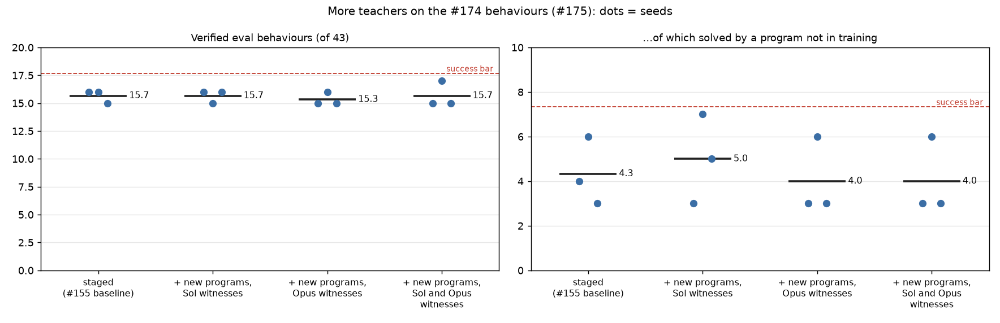

# teacher-variety (#175): a second teacher and every witness, no gain

**Question.** distinct-programs (#174) added 395 behaviours witnessed by gpt-6-sol and verified eval behaviours stayed at 15.67. Do Opus 5.5's witnesses for the same behaviours, or both teachers' together, move them?

**Data.** The 401 audited #174 behaviours, witnessed by Opus 5.5 medium, blind to Sol: 399 verified (207 staged / 91 plain / 101 rule_break vs Sol's 96 / 78 / 221), 40 tasks each, `tasks_opus.jsonl` (gitignored, BIG-bench canary). A behaviour's tasks are drawn from its id, so its Sol and Opus tasks share examples.

**Arms.** #174 recipe (1m policy, seeds 0/1/2, epoch 3, 300-task / 43-behaviour cohort, beam 64 × depth 48, 10 s cap, verified = 10,000-draw `genuine` or catalogue-equal), exposure-matched rows. `staged` and `staged_new` cells are #174's, copied.
- `staged_opus`: staged v4 + Opus witnesses (1,100,418 rows/epoch).
- `all`: staged v4 + each new task with its Sol and Opus witness, witness-uniform (1,102,390 rows/epoch). Fused v4 witnesses left out: #155's `both` showed they cost 1.67.

| arm | graded tasks | verified tasks | verified behaviours /43 | union | novel | only contained |
|---|---|---|---|---:|---|---|
| staged | 139.67 (143 / 128 / 148) | 137.67 | 15.67 (16 / 16 / 15) | 16 | 4.33 (4 / 6 / 3) | 11.33 |
| staged_new (Sol) | 115.67 (116 / 113 / 118) | 112.33 | 15.67 (16 / 15 / 16) | 17 | 5.00 (3 / 7 / 5) | 10.67 |
| staged_opus | 119.67 (120 / 118 / 121) | 113.33 | 15.33 (15 / 16 / 15) | 16 | 4.00 (3 / 6 / 3) | 11.33 |
| all | 139.67 (138 / 148 / 133) | 132.67 | 15.67 (15 / 17 / 15) | 17 | 4.00 (3 / 6 / 3) | 11.67 |

**Verdict: not met on either part** (bar: verified ≥ 17.67 with every seed > 16; novel ≥ 7.33). `prefix_sums` (the #174 audit leak) is verified in `all` s0 and s1 only; without it `all` is **15.00 (14 / 16 / 15)**. The teacher does not matter: Opus 15.33 vs Sol 15.67, and the union differs from staged's by one behaviour (`axis_point_count` in, `all_positive` out). Two witnesses per new task recover the graded tasks the one-teacher arms lost (139.7 vs ~117), without new behaviours. Validation CE on the fused v4 holdout rises every epoch in every arm (e.g. `staged_opus` s0 1.78 → 2.67), as in #174.

**Reading.** Across #174 and #175, 220 → 615 training behaviours and one → two teachers leave verified behaviours at 15–16 of 43, and ~11 of those are solved only by programs contained in training. At this recipe the binding constraint is neither behaviour count nor teacher; model/recipe capacity or the train–eval distance are what is left.

**Train–eval gap check (CPU, after the verdict).** Every training program (1,017: v4 fit witnesses fused and staged, plus the Sol and Opus witnesses) is run on every one of each eval behaviour's cohort examples (deduplicated). **Nearest** is the best fraction any one program gets right. Solve count is over the 12 cells above. `gap.md`, `gap.json`, `experiments/teacher_variety/gap.py`.

| eval behaviours | n | nearest, v4 programs | nearest, all programs | witness ops, median (range) |
|---|---:|---:|---:|---|
| solved in ≥ 6 of 12 cells | 16 | 0.27 | 0.42 | 6.5 (4–40) |
| never solved | 25 | 0.33 | 0.38 | 59 (15–253) |

Output closeness to training does not predict a solve; length does. Five behaviours solved in every cell (`n_minus_each`, `push_back`, `increment_each`, `capped_sum`, `negate_each`) have no training program above 0.10. Three that are never solved have one at 0.69–0.84 (`positive_balance_prefix_count`, `positive_majority_three`, `nondecreasing_indicator`; two are boolean flags, so chance agreement is high). The new behaviours did pull `keep_zeros` and `reverse` to ≥ 0.84, but staged already solved both in every seed. Every never-solved behaviour's witness is ≥ 15 ops, and 22 of 25 are ≥ 30. The ceiling is how long a program the policy and beam can write. That is the #156 / #160 question, not data coverage. Caveat: agreement on examples is a behavioural proxy and says nothing about how similar the programs are.

Files: `graded.md`, `verified.md`, `verified_solves.json`, `containment.json` / `.md`, `arms.png`. Run dir `checkpoints/teacher-variety-20260927` (main checkout).
